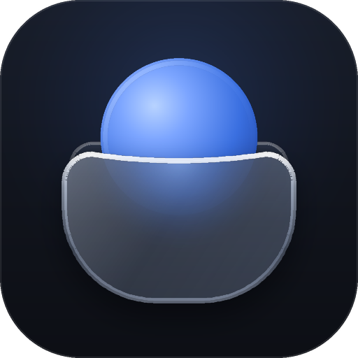
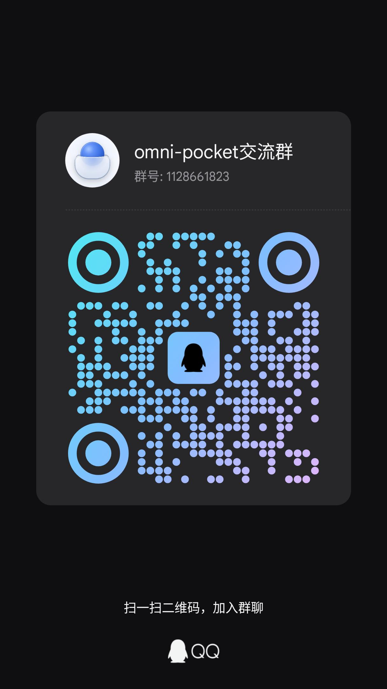
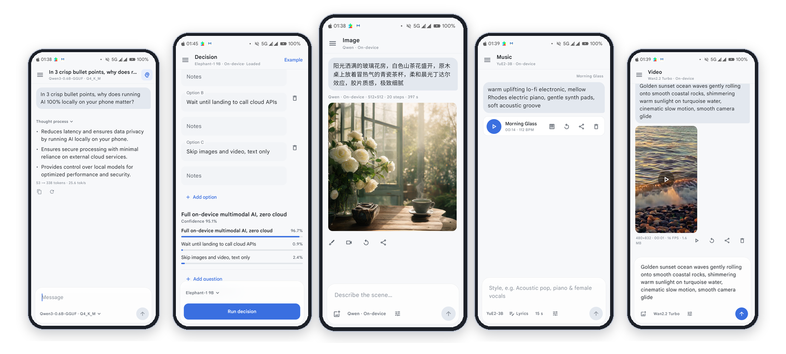
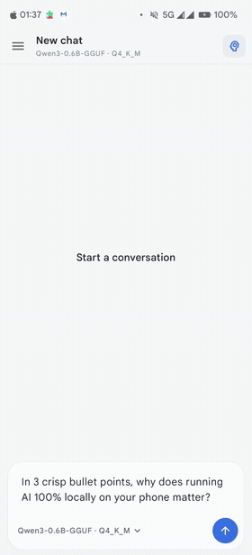
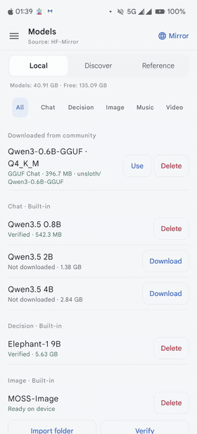
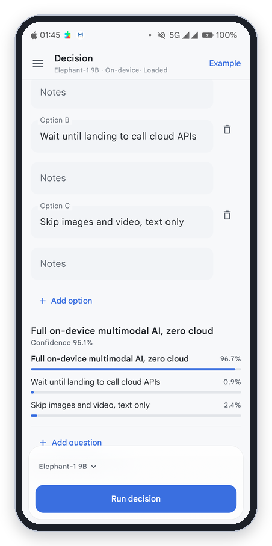
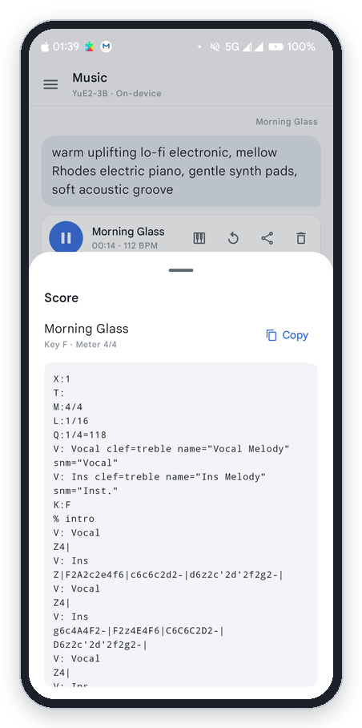
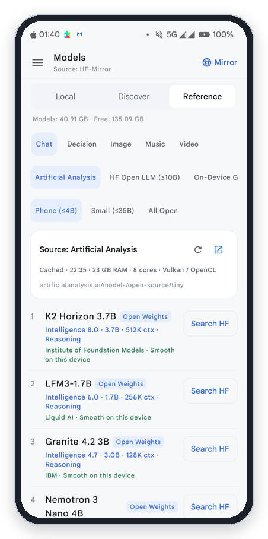
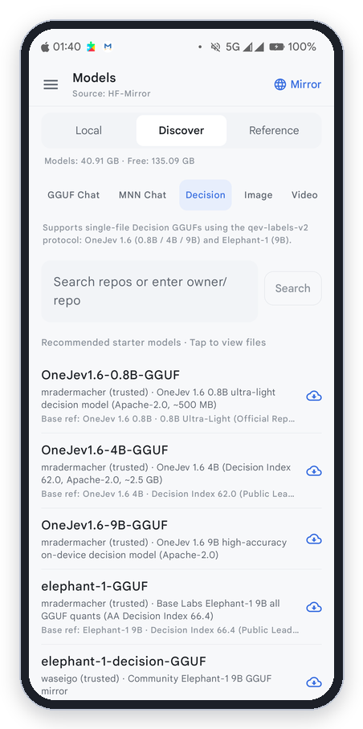
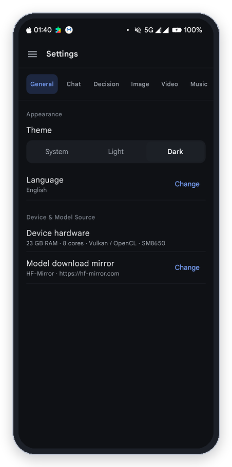

<p align="center">
  <picture>
    <source media="(prefers-color-scheme: dark)" srcset="docs/assets/logo-dark.png" />
    
  </picture>
</p>

<h1 align="center">Omni Pocket</h1>

<p align="center">
  <strong>Five AI modalities. One pocket. Zero cloud.</strong><br />
  On-device Chat, Decision, Image, Music &amp; Video Studio for Android (<code>arm64-v8a</code>).
</p>

<p align="center">
  <a href="https://github.com/Tiggy-Chan/omni-pocket/releases/tag/v0.2.2"></a>
  
  
  
  <a href="#upstream--licenses"></a>
</p>

<p align="center">
  <a href="README.md"><strong>English</strong></a> · <a href="README_CN.md">简体中文</a> · <a href="https://github.com/Tiggy-Chan/omni-pocket/releases">Download APK</a>
</p>

## Community

Join the Omni Pocket QQ community for release updates, on-device testing, model compatibility notes, and user discussion.

<p align="center">
  
</p>

<p align="center">
  <strong>QQ group: omni-pocket交流群 · 1128661823</strong><br />
  Scan the QR code to join the discussion.
</p>

<p align="center">
  
</p>

**Omni Pocket** turns an Android phone into a completely self-contained multimodal AI studio. Every token, probability distribution, painting, 48 kHz audio track, and video frame is computed directly on your device — **no cloud accounts, no API keys, no remote workstation, and no internet connection required after downloading weights**.

---

## Real On-Device Demos

Every screenshot, animation, image, and video clip below was captured live on a retail Android phone (`arm64-v8a`, Snapdragon 8 Gen 3, 24 GB RAM) running Omni Pocket completely locally.

<table>
  <tr>
    <td align="center" width="25%">
      <br />
      <strong>Streaming Local Chat</strong><br />
      <sub><code>Qwen3-0.6B GGUF</code> · live <code>&lt;think&gt;</code> trace · ~26–30 tok/s</sub>
    </td>
    <td align="center" width="25%">
      <br />
      <strong>On-Device Artwork</strong><br />
      <sub><code>Qwen-Image 2.1</code> · 512×512 rendered locally via OpenCL</sub>
    </td>
    <td align="center" width="25%">
      <br />
      <strong>On-Device Video</strong><br />
      <sub><code>Wan2.2-TI2V-5B</code> · 480×832 · 25 frames rendered on phone</sub>
    </td>
    <td align="center" width="25%">
      <br />
      <strong>Model Hub &amp; Leaderboards</strong><br />
      <sub>Live Artificial Analysis rankings &amp; 1-tap HF downloads</sub>
    </td>
  </tr>
</table>

---

## Five Local Modalities, One Unified Studio

| Modality | Built-in & Community Models | Local Runtime & Acceleration | Key Capabilities |
| :--- | :--- | :--- | :--- |
| **Chat** | Built-in `Qwen3.5 0.8B / 2B / 4B` (MNN) + any single-file **GGUF** (`Qwen3.5`, `Qwen3-VL`, `Gemma 4`, `Gemma 3`, `Qwen3`, `Llama 3`, `DeepSeek-R1`, `Phi`, `MiniCPM`) with paired **`mmproj`** vision projectors, community MNN bundles, and GGUF Embedding models (`bge-small-zh-v1.5`) | `libMNN.so` + `llama.cpp` (`mtmd` vision + **Arm KleidiAI**, `-O3`, `armv8.2-a+dotprod+fp16`, Vulkan / OpenCL GPU offload with automatic CPU fallback, Eco / Balanced / Performance thermal modes) | Streaming replies, collapsible `<think>` trace, **Vision chat** (`mmproj` image understanding), **Reading Summary** (`.pdf`/`.docx`/`.md`/`.html`/`.txt` Map-Reduce), **Local Knowledge Base RAG** (SQLite vector store + citations), custom `512–131072` context, KV quantization & prefix reuse, Markdown / PDF export |
| **Decision** | Built-in [`baselabs/elephant-1`](https://huggingface.co/baselabs/elephant-1) 9B (`Q4_K_M`) + community **OneJev 1.6 (0.8B / 4B / 9B)** & **Elephant-1** GGUFs (`qev-labels-v2`) | `llama.cpp` + Arm KleidiAI (block-bidirectional full-attention, ARMv8.2 dotprod+fp16, configurable threads) | Single-pass calibrated probabilities & confidence scores for **Choice**, **Yes/No**, and **Score** prompts, Markdown / PDF export |
| **Image** | **Qwen-Image 2.1**, **MOSS-Image SFT**, plus community **FLUX.3 Image Klein**, **ERNIE-Image-Turbo**, **Z-Image-Turbo**, **FLUX.2-Klein 4B/9B**, and **SD 1.5 / SDXL** checkpoints | MNN (int4 encoder + OpenCL DiT) & unified 16KB-aligned `libsd_jni.so` (`stable-diffusion.cpp` OpenCL + VAE tiling in isolated `:engine` process) | Text-to-image, universal **img2img** (with denoise strength) & reference editing (`Qwen-Image`, `FLUX.3/FLUX.2`, `SD 1.5 / SDXL`), native JSON layouts, shared companion reuse |
| **Music** | Built-in **YuE2-3B** + downloadable **ACE-Step 1.5 Turbo/Base**, **HeartMuLa 3B**, and **Stable Audio 3 Small/Medium** GGUFs | Unified 16KB-aligned `libyue2_jni.so` ([audio.cpp](https://github.com/0xShug0/audio.cpp), `armv8.2-a+dotprod` CPU + **Vulkan GPU** in `:engine` process) | 48 kHz stereo WAV synthesis, vocals/instrumentals/SFX, melody CoT with readable **ABC musical notation**, native `MediaCodec` `.m4a` export |
| **Video** | Built-in **Wan2.2-TI2V-5B-Turbo** + community **MiniMax-H3 (pi-H3 2/4-step AV)**, **Wan2.2-5B**, and **Wan2.1-1.3B** GGUF DiT weights | Unified 16KB-aligned `libsd_jni.so` (`SD_WEBM=ON`, `pi-Flow` scheduler, disk weight streaming, `diffusion=GPUOpenCL, te=CPU, vae=CPU` in `:engine` process) | Text-to-video, first-frame / reference-image video (`FL2VA` / `Ref2VA`), joint audio+video (24 fps WebM), native `MediaCodec` H.264/AAC `.mp4` sharing, VAE tiling |

---

## Interface & Open Ecosystem

<p align="center">
  
  
  
  
  
</p>

- **Live Multi-Modality Leaderboards (`Reference`)**: pulls live public rankings from [Artificial Analysis](https://artificialanalysis.ai/) across all 5 modalities (`Open Weights LLMs`, `Decision Index v2.1`, `Image T2I`, `Video T2V`, `Music Vocals / Instrumental`), plus [Jev Decision Index](https://huggingface.co/spaces/multimodalart/jev-decision-index) and [Hugging Face Open LLM Leaderboard (≤10B)](https://huggingface.co/spaces/open-llm-leaderboard/open_llm_leaderboard) — with transparent source attribution, local disk caching, offline curated fallback, real-time device RAM suitability checks, and 1-tap Hugging Face discovery.
- **Hugging Face & `hf-mirror` Model Hub**: switch seamlessly between `https://huggingface.co`, `https://hf-mirror.com` (default for China locales), or any custom HTTPS mirror, with optional gated-repo Access Token and latency test. Multi-GB weights download in the background via `ModelDownloadService` with HTTP `Range` resume, strict `Content-Range` validation, and SHA-256 / LFS OID verification.
- **Local Model Import, On-Device RAG & Native Sharing**: import local `.gguf` / `.safetensors` / MNN weights directly via Android Storage Access Framework (zero storage permissions) with automatic GGUF metadata inspection; summarize `.pdf`/`.docx`/`.md`/`.html`/`.txt` documents or index them into a local SQLite knowledge base with native `llama.cpp` embeddings; share AI outputs directly as `.mp4` (H.264/AAC), `.m4a`, Markdown, or PDF using Android native `MediaCodec`/`MediaMuxer` and `PdfDocument`.
- **Clean 16KB-Aligned Native Architecture & Android 16 Live Updates**: all native runtimes are packaged as 16 KB ELF-aligned JNI shared libraries with zero shell/subprocess execution, isolated inside a private `:engine` worker process, R8-shrunk (~41 MB APK), signed with APK Signature Schemes v1 + v2 + v3, with background keep-alive notifications that upgrade to Android 16+ Live Updates.
- **Calm Glass UI, Tabbed Settings & 14 Languages**: restrained Light & Dark themes with translucent backdrop blur (gracefully degraded on older Android versions), modality-tabbed Settings, and live switching across **14 languages** (`English`, `简体中文`, `繁體中文`, `日本語`, `한국어`, `Deutsch`, `Français`, `Español`, `Italiano`, `Português (Brasil)`, `Русский`, `Nederlands`, `Polski`, `Türkçe`).

---

## Quick Start

1. Download the signed `omni-pocket-v0.2.2-arm64-v8a.apk` from [**GitHub Releases**](https://github.com/Tiggy-Chan/omni-pocket/releases/tag/v0.2.2) and install it on an `arm64-v8a` Android 9+ phone.
2. Open **Models → Local** or **Models → Discover** to pull models directly on your phone (or browse **Models → Reference** to pick top-ranked open weights that fit your phone's RAM).
3. Switch to Airplane Mode whenever you like — every workspace runs 100% offline.

> **Upgrading tip**: Official releases are signed with a persistent release key (`com.tiggy.omnipocket`). Install newer releases directly over older ones without uninstalling so downloaded models under `/sdcard/Android/data/com.tiggy.omnipocket/files/models/` stay intact.

---

## Build from Source

Requirements: JDK 17+, Android SDK 35, Android NDK `28.2.13676358`, CMake, Ninja.

```bash
git submodule update --init --depth 1 third_party/stable-diffusion.cpp third_party/llama.cpp
git -C third_party/stable-diffusion.cpp submodule update --init --depth 1 ggml thirdparty/libwebp thirdparty/libwebm

# Build unified stable-diffusion.cpp (Wan2.2 + MOSS + generic SD) and audio.cpp (YuE2 / ACE-Step / HeartMuLa / Stable Audio)
ANDROID_HOME=<sdk> JOBS=4 bash scripts/build_sd_android.sh
ANDROID_HOME=<sdk> JOBS=4 bash scripts/build_yue2_android.sh

# Run unit tests and assemble Debug APK
./gradlew :app:testDebugUnitTest :app:assembleDebug
adb install -r app/build/outputs/apk/debug/app-debug.apk
```

### Signed Release Build & GitHub Actions

```bash
OMNI_KEYSTORE_PATH=/path/to/release.jks \
OMNI_KEYSTORE_PASSWORD='...' \
OMNI_KEY_ALIAS='...' \
OMNI_KEY_PASSWORD='...' \
./gradlew :app:testDebugUnitTest :app:assembleRelease :qwenimage21:assembleRelease
```

On every `v*` tag push, [`.github/workflows/build.yml`](.github/workflows/build.yml) compiles all native runtimes from pinned commits, executes unit and conversion tests, signs `omni-pocket-<tag>-arm64-v8a.apk` using repository secrets (`RELEASE_KEYSTORE_BASE64`, `RELEASE_KEYSTORE_PASSWORD`, `RELEASE_KEY_ALIAS`, `RELEASE_KEY_PASSWORD`), generates `SHA256SUMS.txt`, and publishes them to the GitHub Release.

<details>
<summary><strong>Optional: Desktop USB Model Push &amp; Host Verification Scripts</strong></summary>

All models can be downloaded inside the app, or prepared on desktop and pushed over USB (set `HF_ENDPOINT=https://hf-mirror.com` when downloading from Mainland China):

```bash
HF_ENDPOINT=https://hf-mirror.com bash scripts/download_llm_models.sh qwen35-0.8b
bash scripts/push_llm_models.sh qwen35-0.8b

HF_ENDPOINT=https://hf-mirror.com bash scripts/download_moss_models.sh
bash scripts/push_moss_models.sh <serial>

HF_ENDPOINT=https://hf-mirror.com bash scripts/push_music_models.sh <serial>
bash scripts/push_video_models.sh <serial>
```

Host verification:

```bash
python3 -m unittest discover -s export -p 'test_conversion_utils.py'
bash scripts/test_llm_host.sh
bash scripts/test_decision_host.sh
```

</details>

---

## Upstream & Licenses

- [MNN](https://github.com/alibaba/MNN) — Apache-2.0 (`24c6cb21`)
- [Qwen-Image runtime](https://github.com/scsonic/libQwenImage21) — Apache-2.0
- [MOSS-Image](https://github.com/OpenMOSS/MOSS-Image) — Apache-2.0
- [stable-diffusion.cpp](https://github.com/leejet/stable-diffusion.cpp) & [ggml](https://github.com/leejet/ggml) — MIT (`95ff7623` + `patches/sd-opencl-conv3d-bias.patch` + `patches/sd-piflow-h3.patch` for [pi-Flow / pi-H3](https://github.com/Lakonik/ComfyUI-piFlow))
- [llama.cpp](https://github.com/ggml-org/llama.cpp) — MIT (`2280f0fd` + `patches/llama-elephant-decision.patch`) & [Arm KleidiAI](https://github.com/ARM-software/kleidiai) — Apache-2.0 (`v1.32.0`)
- [audio.cpp](https://github.com/0xShug0/audio.cpp) — Apache-2.0 (`3a0dd44`); [YuE2](https://github.com/multimodal-art-projection/YuE) weights — CC-BY-NC-4.0
- [Elephant-1](https://huggingface.co/baselabs/elephant-1) — MIT; [OneJev](https://github.com/OmniJev/OneJev) protocol — Apache-2.0
- [Haze](https://github.com/chrisbanes/haze) — Apache-2.0
- **Omni Pocket** application code — **Apache-2.0**

---

## Support the Author

If Omni Pocket helps you run AI freely on your own device, please give this repository a **Star** on GitHub ([`Tiggy-Chan/omni-pocket`](https://github.com/Tiggy-Chan/omni-pocket)) — it means a lot and helps more developers find the project.

Omni Pocket is free, open-source, and offline-first. If you'd like to support ongoing maintenance, you can buy the author a coffee via WeChat Pay or Alipay:

<div align="center">

| WeChat Pay | Alipay |
| :---: | :---: |
|  |  |

</div>
