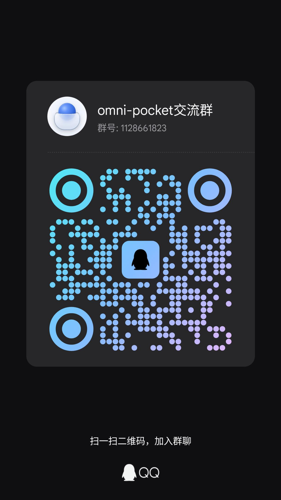
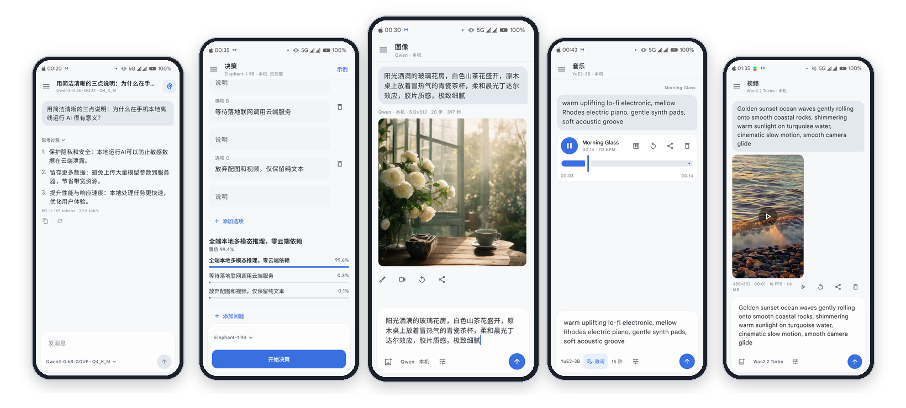
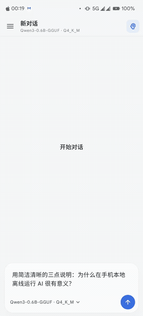
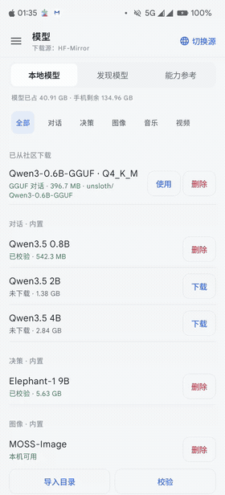
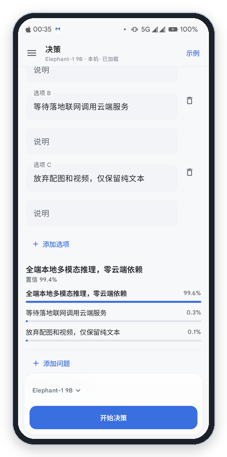
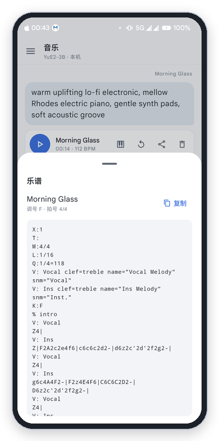
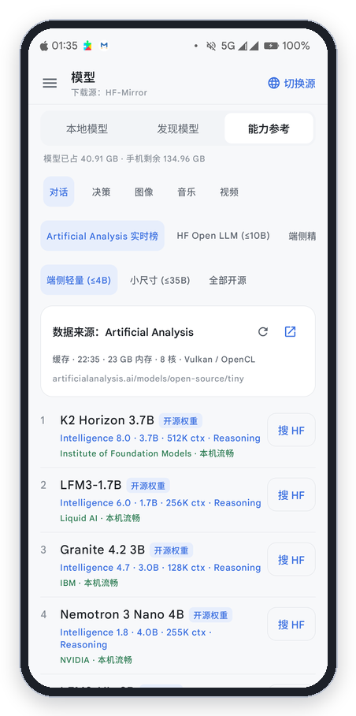
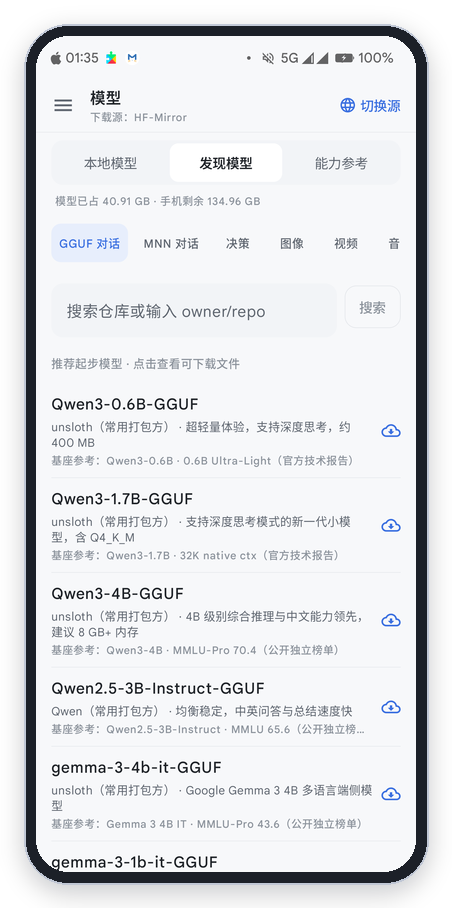
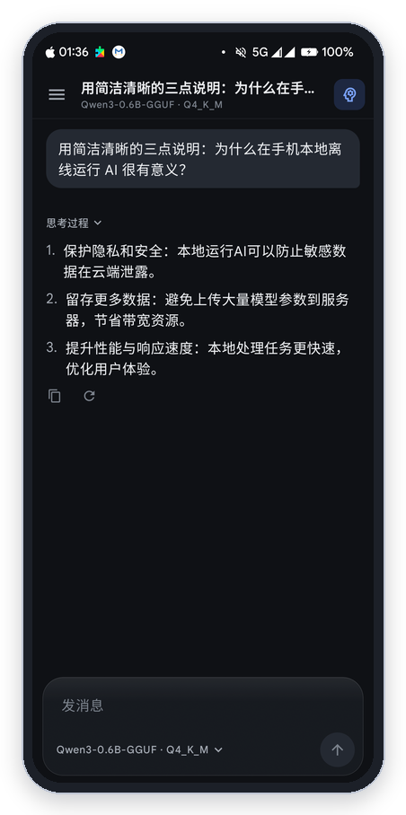

<p align="center">
  <picture>
    <source media="(prefers-color-scheme: dark)" srcset="docs/assets/logo-dark.png" />
    
  </picture>
</p>

<h1 align="center">Omni Pocket</h1>

<p align="center">
  <strong>五种模态，全部装进口袋。全端本地离线，零云端依赖。</strong><br />
  运行在 Android 手机端（<code>arm64-v8a</code>）的本地多模态 AI 对话、决策、图像、音乐与视频工作台。
</p>

<p align="center">
  <a href="https://github.com/Tiggy-Chan/omni-pocket/releases/tag/v0.2.2"></a>
  
  
  
  <a href="#上游项目与许可"></a>
</p>

<p align="center">
  <a href="README.md">English</a> · <a href="README_CN.md"><strong>简体中文</strong></a> · <a href="https://github.com/Tiggy-Chan/omni-pocket/releases">下载安装包</a>
</p>

## 社区交流群

欢迎加入 Omni Pocket QQ 交流群，获取版本更新、手机端实测进展、模型适配信息并参与用户讨论。

<p align="center">
  
</p>

<p align="center">
  <strong>QQ群：omni-pocket交流群 · 1128661823</strong><br />
  扫描上方二维码加入交流群。
</p>

<p align="center">
  
</p>

**Omni Pocket** 把一台普通 Android 手机变成完全独立的离线多模态 AI 工作台。每一段流式思考、每一次概率决策、每一幅图像、每一首 48 kHz 立体声乐曲、每一帧视频，都直接在你的手机本机完成计算 —— **无需云端账号、无需 API Key、无需远程电脑工作站，下载权重后开飞行模式也能全程使用**。

---

## 真实手机端实跑演示

下方所有动图、界面截图、图片与视频作品均在零售 Android 手机（`arm64-v8a`，Snapdragon 8 Gen 3，24 GB 内存）上通过 Omni Pocket **100% 本机离线运行**实时录制与直出。

<table>
  <tr>
    <td align="center" width="25%">
      <br />
      <strong>本地流式对话</strong><br />
      <sub><code>Qwen3-0.6B GGUF</code> · 折叠 <code>&lt;think&gt;</code> · ~29.5 tok/s</sub>
    </td>
    <td align="center" width="25%">
      <br />
      <strong>手机本机生图直出</strong><br />
      <sub><code>Qwen-Image 2.1</code> · 512×512 OpenCL 本地渲染</sub>
    </td>
    <td align="center" width="25%">
      <br />
      <strong>手机本机视频生成</strong><br />
      <sub><code>Wan2.2-TI2V-5B</code> · 480×832 · 25 帧实机渲染</sub>
    </td>
    <td align="center" width="25%">
      <br />
      <strong>模型中心与实时榜单</strong><br />
      <sub>直连 Artificial Analysis · 国内镜像一键拉取</sub>
    </td>
  </tr>
</table>

---

## 五大本地模态与推理引擎

| 模态 | 内置与社区模型生态 | 本机推理引擎与加速 | 核心能力 |
| :--- | :--- | :--- | :--- |
| **对话** | 内置 `Qwen3.5 0.8B / 2B / 4B`（MNN）+ 任意单文件 **GGUF**（`Qwen3.5`、`Qwen3-VL`、`Gemma 4`、`Gemma 3`、`Qwen3`、`Llama 3`、`DeepSeek-R1`、`Phi`、`MiniCPM`）及配套 **`mmproj`** 视觉文件、社区 MNN 包与 GGUF 嵌入模型（`bge-small-zh-v1.5`） | `libMNN.so` + `llama.cpp`（`mtmd` 视觉 + **Arm KleidiAI**、`-O3`、`armv8.2-a+dotprod+fp16`、Vulkan / OpenCL GPU 卸载与自动 CPU 回退、省电/均衡/性能温控档位） | 流式输出、`<think>` 折叠、**多模态识图对话**（`mmproj`）、**文档阅读摘要**（`.pdf`/`.docx`/`.md`/`.html`/`.txt` Map-Reduce）、**本地知识库 RAG**（SQLite 向量检索与引用来源）、`512–131072` 上下文、KV 量化与前缀复用、Markdown / PDF 导出 |
| **决策** | 内置 [`baselabs/elephant-1`](https://huggingface.co/baselabs/elephant-1) 9B（`Q4_K_M`）+ 社区 **OneJev 1.6（0.8B / 4B / 9B）** 与 **Elephant-1** 单文件 GGUF（`qev-labels-v2`） | `llama.cpp` + Arm KleidiAI（块双向全注意力、ARMv8.2 dotprod+fp16、可调 CPU 线程） | 单次前向输出 **选择（Choice）**、**判断（Yes/No）**、**评分（Score）** 的校准概率分布与置信度，支持 Markdown / PDF 导出 |
| **图像** | **Qwen-Image 2.1**、**MOSS-Image SFT**，以及社区 **FLUX.3 Image Klein**、**ERNIE-Image-Turbo**、**Z-Image-Turbo**、**FLUX.2-Klein 4B/9B** 与 **SD 1.5 / SDXL** 权重 | MNN（int4 编码器 + OpenCL DiT）与统一 16KB 页对齐 `libsd_jni.so`（`stable-diffusion.cpp` OpenCL + VAE 分块，独立 `:engine` 进程运行） | 文生图、通用 **图生图（img2img）**（可调重绘强度）与参考图编辑（`Qwen-Image`、`FLUX.3/FLUX.2`、`SD 1.5 / SDXL`）、多区域坐标布局、共享组件自动复用 |
| **音乐** | 内置 **YuE2-3B** + 可下载 **ACE-Step 1.5 Turbo/Base**、**HeartMuLa 3B**、**Stable Audio 3 Small/Medium** GGUF | 统一 16KB 页对齐 `libyue2_jni.so`（[audio.cpp](https://github.com/0xShug0/audio.cpp)，`armv8.2-a+dotprod` CPU + **Vulkan GPU**，独立 `:engine` 进程运行） | 48 kHz 立体声 WAV 合成，支持人声/纯音乐/音效，旋律思考链同步输出可读 **ABC 乐谱**，支持原生 `MediaCodec` 导出 `.m4a` |
| **视频** | 内置 **Wan2.2-TI2V-5B-Turbo** + 社区 **MiniMax-H3（pi-H3 2/4 步音画同步）**、**Wan2.2-5B**、**Wan2.1-1.3B** GGUF DiT 权重 | 统一 16KB 页对齐 `libsd_jni.so`（`SD_WEBM=ON`、`pi-Flow` 调度器、磁盘分段流式加载、`diffusion=GPUOpenCL, te=CPU, vae=CPU`，独立 `:engine` 进程） | 文生视频与首帧/参考图生视频（`FL2VA` / `Ref2VA`）、原生 24 fps 音画同步 WebM、原生 `MediaCodec` 转 `.mp4`（H.264/AAC）分享、VAE 分块解码 |

---

## 界面体验与开放生态

<p align="center">
  
  
  
  
  
</p>

- **全模态实时能力榜单（`能力参考`）**：直接拉取并展示 [Artificial Analysis](https://artificialanalysis.ai/) 全部 5 大模态公开排行榜（`开源 LLM`、`Decision Index v2.1`、`图像 T2I`、`视频 T2V`、`音乐人声与纯音乐`），同时接入 [Jev Decision Index](https://huggingface.co/spaces/multimodalart/jev-decision-index) 与 [Hugging Face Open LLM Leaderboard (≤10B)](https://huggingface.co/spaces/open-llm-leaderboard/open_llm_leaderboard)；清晰标注原始数据来源与原文链接，支持本地磁盘缓存、离线端侧精选降级、按当前手机内存实时评估流畅度，并可一键跳转到 Hugging Face 搜索下载。
- **Hugging Face 与国内镜像无缝切换**：在 **模型 → 切换源** 或 **设置 → 模型下载镜像** 中一键切换 `Hugging Face (https://huggingface.co)`、`HF-Mirror 国内镜像 (https://hf-mirror.com)`（中国大陆语言环境默认启用）或自定义 HTTPS 镜像，支持填写受限仓库 Access Token 与延迟测速。数 GB 权重通过 `ModelDownloadService` 前台服务后台稳定下载，支持断点续传、严格 `Content-Range` 校验与 SHA-256 / LFS OID 完整性校验。
- **本地模型零权限导入、本地 RAG 与原生导出分享**：通过 Android 系统文件选择器（SAF）零权限导入手机本地 `.gguf` / `.safetensors` / MNN 模型并自动解析 GGUF 元数据；支持 `.pdf`/`.docx`/`.md`/`.html`/`.txt` 文档摘要与本地 SQLite 向量知识库检索（原生 `llama.cpp` Embedding）；视频/音乐/对话结果可通过系统原生 `MediaCodec`/`MediaMuxer` 与 `PdfDocument` 直接导出 `.mp4`、`.m4a`、Markdown 与 PDF 分享。
- **合规 16KB 原生架构、R8 轻量瘦身与 Android 16 实时胶囊**：全部推理引擎封装为 16KB ELF 页对齐原生 JNI 动态库，无任何命令行子进程调用，隔离运行于私有 `:engine` 进程，经 R8 裁剪后包体仅约 41 MB，支持 APK v1 + v2 + v3 完整签名与后台保活通知（Android 16+ 自动升级为 Live Updates 实时进度胶囊）。
- **安静克制的玻璃界面、分页设置与 14 种语言**：采用真实 backdrop blur 与高光折射的浅色/深色玻璃界面（老版本 Android 平滑降级），按模态清晰分页的设置页，默认跟随系统并支持即时切换 **14 种常用语言**（`English`、`简体中文`、`繁體中文`、`日本語`、`한국어`、`Deutsch`、`Français`、`Español`、`Italiano`、`Português (Brasil)`、`Русский`、`Nederlands`、`Polski`、`Türkçe`）。

---

## 快速上手

1. 前往 [**GitHub Releases**](https://github.com/Tiggy-Chan/omni-pocket/releases/tag/v0.2.2) 下载正式签名版 `omni-pocket-v0.2.2-arm64-v8a.apk`，安装到 `arm64-v8a` Android 9+ 手机。
2. 打开 **模型 → 本地模型** 或 **模型 → 发现模型** 直接在手机端拉取模型（也可先在 **模型 → 能力参考** 查看各模态榜单与本机内存适配评估）。
3. 权重就绪后即可随时离线使用，全部 5 个工作区零云端请求。

> **覆盖升级提示**：正式版均使用固定签名密钥签发（包名 `com.tiggy.omnipocket`）。后续升级请直接覆盖安装，**切勿卸载重装**，以免系统清空 `/sdcard/Android/data/com.tiggy.omnipocket/files/models/` 下已下载的模型文件。

---

## 从源码编译

环境要求：JDK 17+、Android SDK 35、Android NDK `28.2.13676358`、CMake、Ninja。

```bash
git submodule update --init --depth 1 third_party/stable-diffusion.cpp third_party/llama.cpp
git -C third_party/stable-diffusion.cpp submodule update --init --depth 1 ggml thirdparty/libwebp thirdparty/libwebm

# 编译统一 stable-diffusion.cpp（Wan2.2 + MOSS + 通用 SD）与 audio.cpp（YuE2 / ACE-Step / HeartMuLa / Stable Audio）
ANDROID_HOME=<sdk> JOBS=4 bash scripts/build_sd_android.sh
ANDROID_HOME=<sdk> JOBS=4 bash scripts/build_yue2_android.sh

# 运行单元测试并打包 Debug APK
./gradlew :app:testDebugUnitTest :app:assembleDebug
adb install -r app/build/outputs/apk/debug/app-debug.apk
```

### 正式签名打包与 GitHub Actions 自动发布

```bash
OMNI_KEYSTORE_PATH=/path/to/release.jks \
OMNI_KEYSTORE_PASSWORD='...' \
OMNI_KEY_ALIAS='...' \
OMNI_KEY_PASSWORD='...' \
./gradlew :app:testDebugUnitTest :app:assembleRelease :qwenimage21:assembleRelease
```

推送 `v*` 版本标签后，[`.github/workflows/build.yml`](.github/workflows/build.yml) 会基于锁定版本自动编译全部原生推理引擎、执行测试、使用仓库 Secrets（`RELEASE_KEYSTORE_BASE64`、`RELEASE_KEYSTORE_PASSWORD`、`RELEASE_KEY_ALIAS`、`RELEASE_KEY_PASSWORD`）签发 `omni-pocket-<tag>-arm64-v8a.apk` 与 `SHA256SUMS.txt` 并上传至 GitHub Release。

<details>
<summary><strong>可选：电脑端 USB 推送模型与主机校验脚本</strong></summary>

所有模态均支持在手机 App 内直接下载；如需在电脑端拉取再通过 USB 推送，国内可加 `HF_ENDPOINT=https://hf-mirror.com`：

```bash
HF_ENDPOINT=https://hf-mirror.com bash scripts/download_llm_models.sh qwen35-0.8b
bash scripts/push_llm_models.sh qwen35-0.8b

HF_ENDPOINT=https://hf-mirror.com bash scripts/download_moss_models.sh
bash scripts/push_moss_models.sh <serial>

HF_ENDPOINT=https://hf-mirror.com bash scripts/push_music_models.sh <serial>
bash scripts/push_video_models.sh <serial>
```

主机与导出校验：

```bash
python3 -m unittest discover -s export -p 'test_conversion_utils.py'
bash scripts/test_llm_host.sh
bash scripts/test_decision_host.sh
```

</details>

---

## 上游项目与许可

- [MNN](https://github.com/alibaba/MNN) — Apache-2.0（`24c6cb21`）
- [Qwen-Image 运行时](https://github.com/scsonic/libQwenImage21) — Apache-2.0
- [MOSS-Image](https://github.com/OpenMOSS/MOSS-Image) — Apache-2.0
- [stable-diffusion.cpp](https://github.com/leejet/stable-diffusion.cpp) 与 [ggml](https://github.com/leejet/ggml) — MIT（`95ff7623` + `patches/sd-opencl-conv3d-bias.patch` + `patches/sd-piflow-h3.patch`，集成 [pi-Flow / pi-H3](https://github.com/Lakonik/ComfyUI-piFlow)）
- [llama.cpp](https://github.com/ggml-org/llama.cpp) — MIT（`2280f0fd` + `patches/llama-elephant-decision.patch`）与 [Arm KleidiAI](https://github.com/ARM-software/kleidiai) — Apache-2.0（`v1.32.0`）
- [audio.cpp](https://github.com/0xShug0/audio.cpp) — Apache-2.0（`3a0dd44`）；[YuE2](https://github.com/multimodal-art-projection/YuE) 权重 — CC-BY-NC-4.0（仅限非商业）
- [Elephant-1](https://huggingface.co/baselabs/elephant-1) — MIT；[OneJev](https://github.com/OmniJev/OneJev) 协议 — Apache-2.0
- [Haze](https://github.com/chrisbanes/haze) — Apache-2.0
- **Omni Pocket** 应用代码 — **Apache-2.0**

---

## 支持作者

如果 Omni Pocket 让你在手机上更自由地体验本地 AI，欢迎前往 GitHub 给本仓库点一颗 **Star**（[`Tiggy-Chan/omni-pocket`](https://github.com/Tiggy-Chan/omni-pocket)）—— 你的支持会让更多开发者看到这个项目。

Omni Pocket 免费开源、全端本地运行。如果你喜欢这个项目，可以通过微信或支付宝请作者喝杯咖啡：

<div align="center">

| 微信赞赏 | 支付宝 |
| :---: | :---: |
|  |  |

</div>
